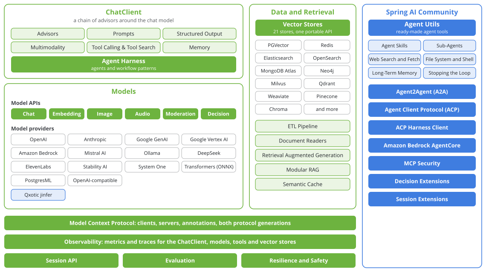

<!-- YUDAO-COMPATIBILITY-INTRO-BEGIN -->

上游参考文档已同步至 `d3a8ceb41`。构建文档时使用上游版本生成页面路径，Maven 制品沿用各 JDK 路线的版本号。

> 版本命名：保留当前源码基线的官方版本号；共用现代制品不加 JDK 后缀，隔离维护的兼容路线添加 `jdk8` / `jdk17` / `jdk25`。开发版本使用 SNAPSHOT。JDK 路线后缀不等于最低字节码版本，框架依赖仍按 Boot 版本选择。
> 完整版本规则与预览命名见 [VERSIONING.md](VERSIONING.md)。

# yudao-spring-ai

yudao-spring-ai 是 [Spring AI](https://github.com/spring-projects/spring-ai) 的芋道社区兼容维护版本，并非官方发布。主要为 **Spring Boot 2.x、Spring Boot 3.x** 项目回迁较新版本 Spring AI 的能力；`main` 保留 Spring Boot 4.x 版本线。

## 仓库与版本线

| 平台 | 仓库地址 |
| --- | --- |
| Gitee | [yudao-spring-ai](https://gitee.com/yudaocode/yudao-spring-ai) |
| GitHub | [yudao-spring-ai](https://github.com/yudaocode/yudao-spring-ai) |

| 分支 | 已验证 Spring Boot | 运行 JDK | 源码开发版本 | Maven Central |
| --- | --- | --- | --- | --- |
| [`main`](https://github.com/yudaocode/yudao-spring-ai/tree/main) | 4.2.0 | 17+（业务消费使用25） | `2.1.1-jdk25-SNAPSHOT` | [2.1.0-jdk25-preview-20261119](https://central.sonatype.com/artifact/cn.iocoder.spring-ai/spring-ai-bom/2.1.0-jdk25-preview-20261119) |
| [`main-jdk17`](https://github.com/yudaocode/yudao-spring-ai/tree/main-jdk17) | 3.5.15 | 17+ | `2.1.1-jdk17-SNAPSHOT` | [2.1.0-jdk17-preview-20261118](https://central.sonatype.com/artifact/cn.iocoder.spring-ai/spring-ai-bom/2.1.0-jdk17-preview-20261118) |
| [`main-jdk8`](https://github.com/yudaocode/yudao-spring-ai/tree/main-jdk8) | 2.7.18 | 8+ | `2.1.1-jdk8-SNAPSHOT` | [2.1.0-jdk8-preview-20261119](https://central.sonatype.com/artifact/cn.iocoder.spring-ai/spring-ai-bom/2.1.0-jdk8-preview-20261119) |

版本保留上游源码基线编号，以 JDK 路线隔离 Boot 依赖；发布时追加北京时间日期，不增加同日序号。当前分支：**`main-jdk8`**。

Maven groupId 为 **`cn.iocoder.spring-ai`**，artifactId 和 Java 包名沿用官方。同一个应用只选择一条版本线，同一项目的模块使用同一版本；替换已有依赖时，也要移除对应官方 groupId 下的同类模块，避免重复类。

Boot 2 / JDK 8 兼容版 [2.1.0-jdk8-preview-20261119](https://central.sonatype.com/artifact/cn.iocoder.spring-ai/spring-ai-bom/2.1.0-jdk8-preview-20261119) 已发布到 Maven Central。下面的 Maven 示例直接使用发布坐标。发布版本按 `官方版本[-jdk数字][-preview]-YYYYMMDD` 命名；共用制品省略 JDK，未发布上游基线增加 preview，无同日序号。

## 如何使用

如需构建 SNAPSHOT 源码，使用 JDK 17.0.19+；Java 8 分支同样使用 JDK 17 构建，产物供 JDK 8 运行。

```bash
git clone -b main-jdk8 https://github.com/yudaocode/yudao-spring-ai.git
cd yudao-spring-ai
bash ./mvnw -DskipTests -Dmaven.javadoc.skip=true install
```

宿主保留自己的 Spring Boot parent/BOM。下面以 OpenAI starter 为例，其他模型按需选择对应 starter：

```xml
<properties>
    <yudao-spring-ai.version>2.1.0-jdk8-preview-20261119</yudao-spring-ai.version>
</properties>
<dependencyManagement>
    <dependencies>
        <dependency>
            <groupId>cn.iocoder.spring-ai</groupId>
            <artifactId>spring-ai-bom</artifactId>
            <version>${yudao-spring-ai.version}</version>
            <type>pom</type>
            <scope>import</scope>
        </dependency>
    </dependencies>
</dependencyManagement>
<dependencies>
    <dependency>
        <groupId>cn.iocoder.spring-ai</groupId>
        <artifactId>spring-ai-starter-model-openai</artifactId>
    </dependency>
</dependencies>
```

```yaml
spring:
  ai:
    openai:
      api-key: ${OPENAI_API_KEY}
      chat:
        options:
          model: gpt-4o-mini
```

配置环境变量后，注入 `ChatModel` 或 `ChatClient.Builder` 使用；Java 导入仍为 `org.springframework.ai.*`。例如注入名为 `builder` 的 `ChatClient.Builder` 后，调用 `builder.build().prompt("你好").call().content()`。

Java 8 分支默认构建另包含 Agent Utils 0.13.0 的 common/tools 兼容模块，Dream 已适配当前 Session API，且保留官方默认提示词资源。
使用 `cn.iocoder.spring-ai:spring-ai-agent-utils-compat`，不要同时引入官方同名类；Dream 需要应用显式提供 `spring-ai-session`。
依赖示例、principal 隔离与分页约定见 [Agent Utils 使用说明](compatibility/agent-utils/README.md)。

MCP 的 Jackson2 schema 运行库已排除重复的官方 ITU，统一使用随兼容版提供的 Java8-safe ITU1.17；宿主不要再引入原版 `com.ethlo.time:itu`。

Java8 的 OpenSearch starter 现使用 3.11.0 客户端兼容制品，修复原始 major52 字节码中仍调用 Java9 ByteBuffer 方法的问题。
SDK 保留原包名，两个原始类按 Java8 API 重编译，其他6,610个载荷条目逐字节校验。
Boot2 parent 下还需覆盖 HTTP5/Core5 与 JSON-P/JSON-B/Yasson 版本；完整依赖、两种 starter 和本地签名验收见 [OpenSearch 使用说明](compatibility/opensearch-client/README.md)。

详细构建、源码基线、API 差异及当前支持边界见 [COMPATIBILITY.md](COMPATIBILITY.md)。

下方逐字保留官方项目原始 README，其中的官方 Maven 坐标和发布状态仅针对上游项目；使用本兼容版时，以本节坐标、版本线和支持范围为准。

OpenSearch2.19.3 的精确余弦评分已补三线统一配置：设置 `spring.ai.vectorstore.opensearch.cosine-similarity-score-boost=1.0`，或 builder 的 `cosineSimilarityScoreBoost(1.0f)`。
保留旧引擎默认0.5，近似检索及其他距离不变。
真实引擎已验证相同向量得分1.0与0.9阈值；Boot2/JDK8消费7项、Boot3/4在JDK17/25各4项均零失败/错误/跳过。
完整用法、验证边界见 [COMPATIBILITY.md](COMPATIBILITY.md#exact-cosine-scores-with-opensearch-219)。

Coherence 向量库已接入 Java8 版本线：引入 `cn.iocoder.spring-ai:spring-ai-coherence-store`，由 BOM 管理版本。
运行核心为 Coherence14.1.1-0-29，向量/HNSW 能力从24.09源码移植；需要显式配置存储节点和 POF 类型，不能混入官方24.09 Java17运行库。
原生JDK8的18项单测、28项集成测试（含两个独立进程与真实MiniLM推理）和独立Boot2消费测试均通过。
196模块完整 native8 clean install 检查点已通过8072项测试，零失败/错误、17项条件跳过；上述集成和独立消费门禁另列。
完整配置、使用示例和支持边界见 [Coherence 使用说明](compatibility/coherence-ai/README.md)。

Java8 版本线的 Testcontainers 批次已恢复 `spring-ai-spring-boot-testcontainers`，当时默认构建扩至200模块。
使用 `cn.iocoder.spring-ai:spring-ai-spring-boot-testcontainers`（test scope），可使用 `@ServiceConnection`、`@ImportTestcontainers` 和动态属性，容器随 Boot2 上下文启动、停止。
这一批58项定向单测、4项真实Docker集成、2项独立Boot2消费测试均在原生JDK8零失败/错误/跳过；9类连接工厂均有SPI/属性映射单测，真实容器覆盖nginx与OpenSearch，并非所有后端均已实服验收。
该批分项门禁与此前196模块全量分别保留；最新202模块全量检查点见下文。
依赖配置、示例和边界见 [Testcontainers 使用说明](compatibility/boot-testcontainers/README.md)。


Java8 版本线已恢复最后的 `spring-ai-spring-boot-docker-compose`，默认构建为202模块。
导入本分支 BOM 后，添加 `cn.iocoder.spring-ai:spring-ai-spring-boot-docker-compose`（test scope），设置 `spring.docker.compose.file` 和 `spring.docker.compose.skip.in-tests=false` 即可用于 Boot2 本地开发测试。
兼容底座从 Boot3.1.12 core/SPI 源码回迁，并补充3.5.15镜像别名匹配；运行依赖保持 Boot2/Spring5/Jackson2，不携带原 Boot3 Compose 二进制。
23项定向单测、2项真实Compose子进程生命周期测试、1项独立Boot2/OpenSearch消费测试均在原生JDK8零失败/错误/跳过。
应用退出时按配置停止自己启动的服务，并保留此前已运行的服务；不额外承诺每次 `context.close()` 均停止共享服务。
Compose 批次 202 模块原生 JDK8 完整 clean install：8121 项测试，零失败/错误，17项条件跳过；测试重试关闭，运行期间Java/POM输入哈希保持一致。
真实服务验收覆盖本批 nginx/OpenSearch，其他后端工厂有SPI/属性映射单测，全部云账号/平台组合及AOT未作为通过项。
使用配置、实际子进程验证与边界见 [Docker Compose 使用说明](compatibility/boot-docker-compose/README.md)。

Java8 HTTP 兼容库现可处理空响应体的 HTTP/1 307、308 跳转。继续由本分支 BOM 管理 `spring-ai-jdk-http-compat`。
原生 JDK8 的 HTTP 31 项、MCP 368 项，以及 AgentScope Kubernetes 原有 65 项和独立 Boot2 消费 2 项均通过。
本次 202 模块完整构建共 8,123 项，0 失败、0 错误、17 项条件跳过。

## Boot 2 会话与聊天记忆验收

Spring Boot 2.7.18 / 原生 JDK 8 用 Docker 通过 236 项仓库集成测试，零失败、零跳过。
JDBC Session 的 MySQL 8.0、PostgreSQL 16、MariaDB 11.4 共通过 178 项，Redis Stack 的 7 组 Chat Memory 用例共通过 58 项。
本地 PostgreSQL 测试连接使用明文模式，Redis 测试通过明确的 Redis Stack 镜像名启动容器。

Boot 2.7.18 / 原生 JDK 8 新增 11 个 Docker 向量后端的真库覆盖，249 项通过、1 项按 Chroma 集合能力跳过。SQL Server 2017 和 2022 分别通过 JDBC Session 70 项和自动配置 4 项。

Weaviate 客户端沿用 5.3.0，Gson 对齐到客户端声明的 2.12.1。使用 Boot 2 parent 的应用应设置 `<gson.version>2.12.1</gson.version>`。独立 Boot 2 项目已从本地安装的 JAR 连接 Weaviate 1.40.5，完成写入、检索和删除。[后端版本及复验参数](COMPATIBILITY.md#boot-2-docker-backend-checks)

Neo4j 5.24 的 Docker 向量库测试在 Boot 2.7.18 / 原生 JDK 8 通过 25 项，覆盖索引、向量写入更新、相似度检索、过滤和删除。

Typesense 27.1 的 Docker 向量库测试在 Boot 2.7.18 / 原生 JDK 8 通过 32 项，覆盖 MiniLM 向量检索、观测及向量更新。

Elasticsearch 9.2.0 的 Docker 向量用例在 Boot 2 / 原生 JDK 8 通过 20 项。适配器使用 Elasticsearch Java 与 REST 客户端 8.18.8。使用 Boot 2 parent 时设置 `elasticsearch.version=8.18.8` 和 `jakarta-json.version=2.0.1`，已用独立 Boot 2 项目连接真库验证本地安装的 JAR。

GemFire VectorDB 10.2 的 ARM64 Docker 冒烟测试在 Boot 2 / 原生 JDK 8 通过，覆盖建索引、写入、检索及删除。可通过 `-Pintegration-tests -Dit.test=GemFireDockerSmokeIT` 定向复验。

MongoDB Atlas Local 8.0.0 的 ARM64 Docker 测试在 Boot 2.7.18 / 原生 JDK 8 通过 44 项，覆盖单条和批量向量写入、更新、检索及删除。公共契约中要求存储适配器能显式配置维度的 2 项按既有能力条件跳过。

Boot 2.7.18 / 原生 JDK 8 的聊天记忆 Docker 补验通过 50 项，其中 Cassandra 5.0 为 9 项、MongoDB 8.0.6 为 10 项、Neo4j 5 为 31 项，零跳过。MongoDB 集成测试使用 Boot 2 的 `spring.data.mongodb.uri` 连接测试容器。

Boot 2.7.18 / 原生 JDK 8u472 的 MCP WebFlux Docker 回归每种 JVM 通过 200 项，覆盖 SSE 和 Streamable HTTP 的同步及异步客户端。2 项请求定制公共测试按原有能力条件跳过。测试服务器使用 Node 26 与 MCP server-everything 2025.12.18。

Ollama 0.40.9 的 ARM64 Docker 服务在 Boot 2.7.18 / 原生 JDK 8u472 每种 JVM 通过 2 项向量用例，使用 `nomic-embed-text` 和 `all-minilm`，覆盖批量向量、维度和附加模型管理，零跳过。

Ollama 0.40.9 的 ARM64 Docker 容器使用 `qwen3-embedding:8b`，在 Boot 2.7.18 / 原生 JDK 8u472 每种 JVM 通过 9 项集成测试。
向量默认返回 4096 维，`dimensions` 可指定为 512 或 1024。
使用 512 token 上下文时，`truncate=true` 对超长输入返回向量，`truncate=false` 返回 HTTP 400，短输入可正常编码。

## Docker Model Runner 真服务验收

在隔离的 Linux ARM64 Docker 容器内启动官方 Docker Model Runner 独立版，使用 `ai/smollm2:135M-Q4_K_M`，通过 OpenAI starter 自动配置验证 Chat Completions。Boot 2.7.18 / JDK 8、Boot 3.5.15 与 Boot 4.1.2 / JDK 17、25 共 5 组，每组 2 项，全部通过。覆盖同步聊天、SSE 流式聊天、结束原因和 token 用量。上游停用套件沿用原配置。同一矩阵另使用 Qwen3 0.6B 验证非流式 Java 工具回合与 strict JSON Schema 输出，每组新增 2 项通过。[复验步骤](compatibility-tests/docker-model-runner/README.md)

<!-- YUDAO-COMPATIBILITY-INTRO-END -->

## Java 8 HTTP 响应与流式文本

Boot 2 路线的 `cn.iocoder.spring-ai:spring-ai-jdk-http-compat` 提供请求复制、按 HTTP 状态和响应头选择处理器，以及 UTF-8 流式文本订阅，用于本分支与 Java 8 上的 Watsonx 等 SDK。普通 HTTP 调用仍使用原响应处理器。

---

# Spring AI [](https://github.com/spring-projects/spring-ai/actions/workflows/build-and-deploy-snapshot.yml) [](https://central.sonatype.com/artifact/org.springframework.ai/spring-ai-model)

The Spring AI project provides a Spring-friendly API and abstractions for developing AI applications.

Its goal is to apply Spring ecosystem design principles, such as portability and modular design, to the AI domain and promote using strongly-typed data structures and APIs as the building blocks of an application.

At its core, Spring AI addresses the fundamental challenge of AI integration: connecting your enterprise __Data__ and __APIs__ with the __AI Models__.

<picture>
  <source media="(prefers-color-scheme: dark)" srcset="spring-ai-docs/src/main/antora/modules/ROOT/images/spring-ai-project-map-dark.svg">
  
</picture>

## Getting Started

Create a project on [start.spring.io](https://start.spring.io/) with the *Spring Web* and *OpenAI* dependencies, set the `spring.ai.openai.api-key` property, and inject the auto-configured `ChatClient.Builder`:

```java
@RestController
class ChatController {

    private final ChatClient chatClient;

    ChatController(ChatClient.Builder chatClientBuilder) {
        this.chatClient = chatClientBuilder.build();
    }

    @GetMapping("/ai")
    String ask(@RequestParam(defaultValue = "Tell me a joke") String message) {
        return this.chatClient.prompt()
            .user(message)
            .call()
            .content();
    }

}
```

The [Quickstart](https://docs.spring.io/spring-ai/reference/2.1-SNAPSHOT/get-started/quickstart.html) explains each step and runs the same code against a local model.
From there, continue with:

* [Project Setup](https://docs.spring.io/spring-ai/reference/2.1-SNAPSHOT/get-started/project-setup.html) - the BOM, the starters and the repositories.
* [Choosing a Model Provider](https://docs.spring.io/spring-ai/reference/2.1-SNAPSHOT/get-started/choose-provider.html) - what each provider supports.
* The tutorials: [Chat with Your Documents](https://docs.spring.io/spring-ai/reference/2.1-SNAPSHOT/tutorials/rag.html), [Give the Model Tools](https://docs.spring.io/spring-ai/reference/2.1-SNAPSHOT/tutorials/tools.html), [A Conversational App with Sessions](https://docs.spring.io/spring-ai/reference/2.1-SNAPSHOT/tutorials/sessions.html) and [Build and Use an MCP Server](https://docs.spring.io/spring-ai/reference/2.1-SNAPSHOT/tutorials/mcp.html).

Spring Boot version compatibility:

| Spring AI | Branch | Spring Boot |
|-----------|--------|-------------|
| 2.1.x | [main](https://github.com/spring-projects/spring-ai/tree/main) | 4.2.x |
| 2.0.x | [2.0.x](https://github.com/spring-projects/spring-ai/tree/2.0.x) | 4.1.x |
| 1.1.x | [1.1.x](https://github.com/spring-projects/spring-ai/tree/1.1.x) | 3.5.x |

## Features

This is a high level feature overview.
The [reference documentation](https://docs.spring.io/spring-ai/reference/2.1-SNAPSHOT/) follows the same structure.

### ChatClient

* [ChatClient](https://docs.spring.io/spring-ai/reference/2.1-SNAPSHOT/chatclient/index.html) - Fluent API for communicating with AI chat models, with synchronous and streaming calls, idiomatically similar to the WebClient and RestClient APIs.
* [Advisors](https://docs.spring.io/spring-ai/reference/2.1-SNAPSHOT/advisors/index.html) - Encapsulate recurring generative AI patterns, transform the data sent to and from the model, and provide portability across models and use cases.
* [Prompts and Templates](https://docs.spring.io/spring-ai/reference/2.1-SNAPSHOT/prompts/index.html) - Messages, prompt templates and prompt engineering patterns.
* [Structured Output](https://docs.spring.io/spring-ai/reference/2.1-SNAPSHOT/structured-output/index.html) - Mapping of AI model output to POJOs.
* [Multimodality](https://docs.spring.io/spring-ai/reference/2.1-SNAPSHOT/multimodality.html) - Images, audio and other media next to text in a message.
* [Tool Calling](https://docs.spring.io/spring-ai/reference/2.1-SNAPSHOT/tools/index.html) - Permits the model to request the execution of client-side tools and functions, with [Tool Search](https://docs.spring.io/spring-ai/reference/2.1-SNAPSHOT/tools/tool-search.html) for large tool sets and [Tool Call Confirmation](https://docs.spring.io/spring-ai/reference/2.1-SNAPSHOT/tools/confirmation.html) to let a person approve a call.
* [Memory](https://docs.spring.io/spring-ai/reference/2.1-SNAPSHOT/memory/index.html) - The [Session API](https://docs.spring.io/spring-ai/reference/2.1-SNAPSHOT/memory/session/index.html) keeps a conversation as an append-only log of events, with turn-aware compaction, recall and a JDBC repository.
* [Agents](https://docs.spring.io/spring-ai/reference/2.1-SNAPSHOT/agents/index.html) - The advisor chain of a `ChatClient` and its tools form the agent harness, with examples of the common workflow patterns.

### Models

* Portable [Model APIs](https://docs.spring.io/spring-ai/reference/2.1-SNAPSHOT/models/index.html) across AI providers:
  - [Chat](https://docs.spring.io/spring-ai/reference/2.1-SNAPSHOT/models/chat.html)
  - [Embedding](https://docs.spring.io/spring-ai/reference/2.1-SNAPSHOT/models/embeddings.html)
  - [Image](https://docs.spring.io/spring-ai/reference/2.1-SNAPSHOT/models/image.html)
  - [Text to Speech](https://docs.spring.io/spring-ai/reference/2.1-SNAPSHOT/models/audio/speech.html) and [Audio Transcription](https://docs.spring.io/spring-ai/reference/2.1-SNAPSHOT/models/audio/transcription.html)
  - [Moderation](https://docs.spring.io/spring-ai/reference/2.1-SNAPSHOT/models/moderation.html)
  - [Decision](https://docs.spring.io/spring-ai/reference/2.1-SNAPSHOT/models/decision.html)
* Support for all major [AI Model providers](https://docs.spring.io/spring-ai/reference/2.1-SNAPSHOT/integrations/models/index.html) such as Anthropic, OpenAI, Amazon Bedrock, Google, Ollama, Mistral AI, DeepSeek, and more.
  Access to [model-specific features](https://docs.spring.io/spring-ai/reference/2.1-SNAPSHOT/models/chat.html#_chat_options) is also available.

### Data and Retrieval

* Support for all major [Vector Store providers](https://docs.spring.io/spring-ai/reference/2.1-SNAPSHOT/integrations/vector-stores/index.html) such as *Amazon Bedrock Knowledge Base, Amazon S3, Apache Cassandra, Azure Vector Search, Chroma, Couchbase, Elasticsearch, GemFire, MariaDB, Milvus, MongoDB Atlas, Neo4j, OpenSearch, Oracle, Oracle Coherence, PostgreSQL/PGVector, Pinecone, Qdrant, Redis, Typesense, and Weaviate*.
* Portable [Vector Store API](https://docs.spring.io/spring-ai/reference/2.1-SNAPSHOT/rag/vector-store/index.html) across providers, including a novel SQL-like [metadata filter API](https://docs.spring.io/spring-ai/reference/2.1-SNAPSHOT/rag/vector-store/filters.html).
* Document ingestion [ETL framework](https://docs.spring.io/spring-ai/reference/2.1-SNAPSHOT/rag/etl/index.html) for Data Engineering, with [document readers](https://docs.spring.io/spring-ai/reference/2.1-SNAPSHOT/integrations/document-readers/index.html) for PDF, Markdown, HTML, Office formats and more.
* [Retrieval Augmented Generation (RAG)](https://docs.spring.io/spring-ai/reference/2.1-SNAPSHOT/rag/index.html) - Out-of-the-box RAG flows as advisors, and a modular architecture to build your own.
* [Semantic Caching](https://docs.spring.io/spring-ai/reference/2.1-SNAPSHOT/rag/semantic-cache.html) - Returns a cached response to a semantically similar request.

### Model Context Protocol

* [MCP (Model Context Protocol)](https://docs.spring.io/spring-ai/reference/2.1-SNAPSHOT/mcp/index.html) - First-class support via Boot Starters and MCP Java Annotations for building AI applications that consume MCP servers or expose Spring-based services to the AI ecosystem, for both the modern and the legacy generation of the protocol.

### Across the Application

* [Observability](https://docs.spring.io/spring-ai/reference/2.1-SNAPSHOT/observability/index.html) - Metrics and traces for the `ChatClient`, advisors, models, tool calls and vector stores.
* [Evaluation and Testing](https://docs.spring.io/spring-ai/reference/2.1-SNAPSHOT/evaluation/index.html) - Utilities to help evaluate generated content and protect against hallucinated responses, with Testcontainers and Docker Compose support.
* [Resilience and Safety](https://docs.spring.io/spring-ai/reference/2.1-SNAPSHOT/resilience/index.html) - Retry of failed model calls, and guardrails for unwanted content.
* Spring Boot Auto Configuration and [Starters](https://docs.spring.io/spring-ai/reference/2.1-SNAPSHOT/reference/modules.html) for all AI Models and Vector Stores - use [start.spring.io](https://start.spring.io/) to select the Model or Vector Store of choice.

### Community

* [Community-maintained projects](https://docs.spring.io/spring-ai/reference/2.1-SNAPSHOT/integrations/community/index.html) add agent tools, MCP security, agent protocols and more model and vector store integrations.
  They follow their own release schedule and support terms, which that page describes.

## Project Resources

* [Reference documentation](https://docs.spring.io/spring-ai/reference/)
* [Javadoc](https://docs.spring.io/spring-ai/docs/current/api/)
* [Upgrade notes](https://docs.spring.io/spring-ai/reference/2.1-SNAPSHOT/upgrading/index.html)
* [Modules and Starters](https://docs.spring.io/spring-ai/reference/2.1-SNAPSHOT/reference/modules.html) - Every artifact, with its auto-configuration and starter.
* [Samples and Workshops](https://docs.spring.io/spring-ai/reference/2.1-SNAPSHOT/resources/samples.html)
* [Spring AI Examples](https://github.com/spring-projects/spring-ai-examples) - Contains example projects that explain specific features in more detail.
* [Awesome Spring AI](https://github.com/spring-ai-community/awesome-spring-ai) - A curated list of awesome resources, tools, tutorials, and projects for building generative AI applications using Spring AI
* [Spring AI Community](https://github.com/spring-ai-community) - A community-driven organization for building Spring-based integrations with AI models, agents, vector databases, and more.

## Building from source

You don’t need to build from source to use Spring AI.
If you want to try out the latest and greatest, Spring AI can be built and published to your local Maven repository:
```shell
./mvnw clean install
```
This command builds all modules, runs unit tests, and publishes artifacts to your local Maven repository.

Please read our [contribution guidelines](CONTRIBUTING.md) for more details.

## Contributing

We welcome contributions of all kinds!
Please read our [contribution guidelines](CONTRIBUTING.md) before submitting a pull request or an issue.
